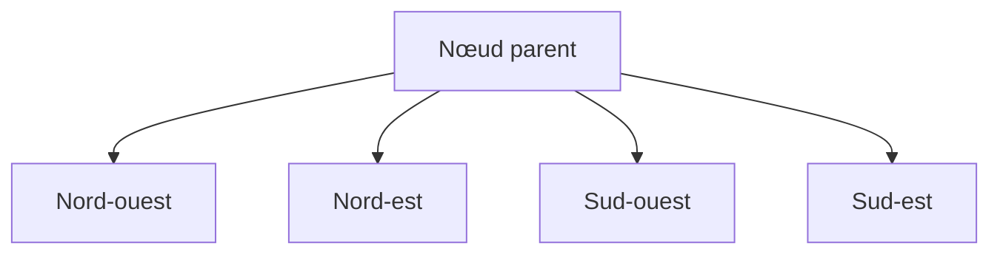
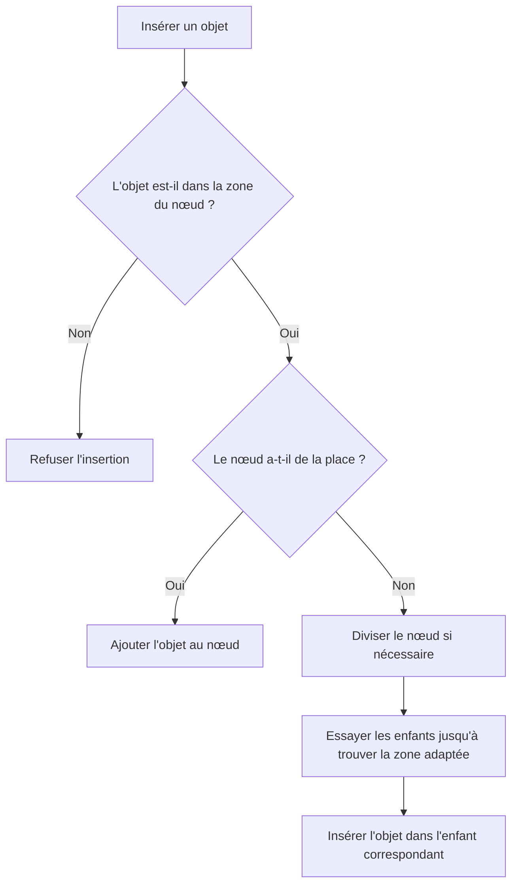
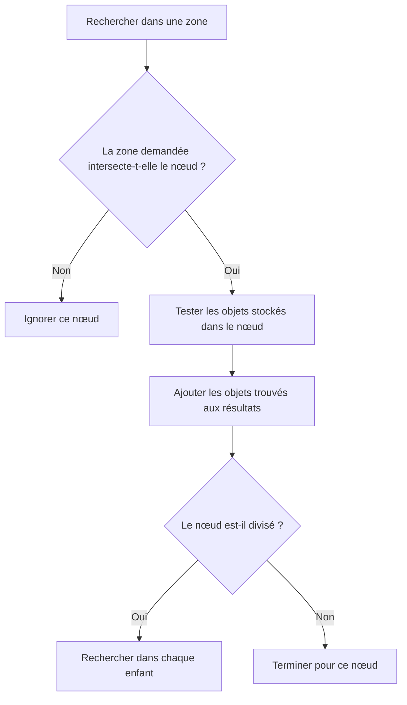
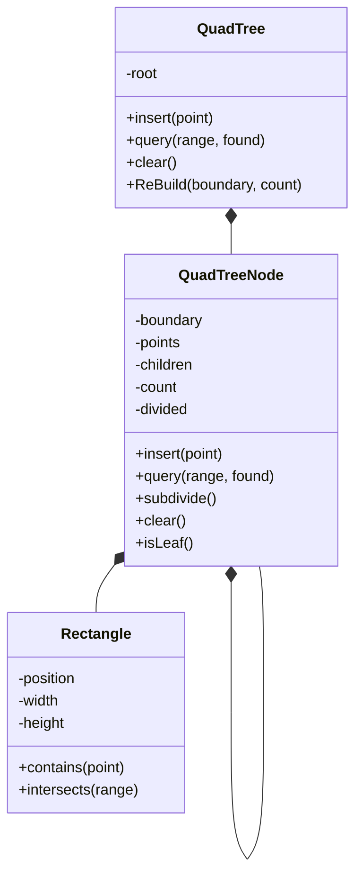
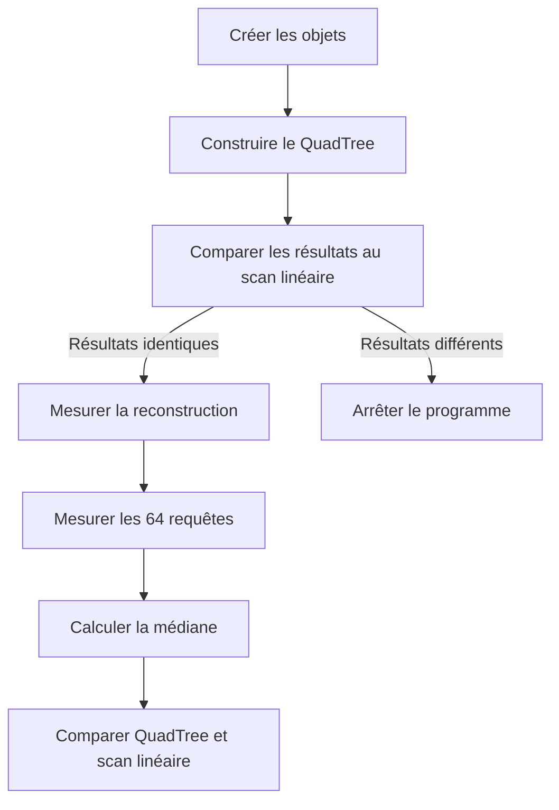
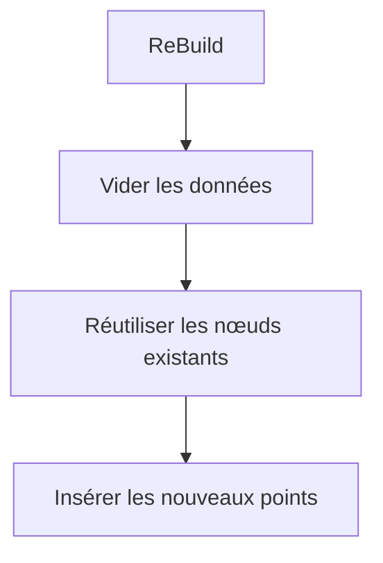

# Amélioration du QuadTree

## Introduction

Dans le cadre de mon moteur physique, j'ai implenter un QuadTree afin d'améliorer la recherche des objet dans une zone du monde.
Mon système est composé d'une classe `QuadTree`, qui gère un noeud racine, et de noeuds `QuadTreeNode`. Chaque noeud possède une zone rectangulaire, un capacité maximal et jusqu'a quatre enfants. Lorsqu'un noeud dépasse sa capacité, il est subdivisé en quatre sous zones à l'aide de `subdivide()`.
L'implémentation permet actuellement d'insérer des objets, d'effectuer une recherche par zone avec `query()` et de reconstruire l'arbre avec  `ReBuild()`. J'ai comparé cette approche avec une recherche linéaire parcourant tous les objets.
Ce blog présente les résultats obtonus, les limites du QuadTree actuel et les optimisations envisageables : réutilisation des noeuds, réduction des copie, amélioration des insertions et des allocations.

---

## Présentation du fonctionnement


### Division d’un nœud

Mon QuadTree organise les objets selon leur position dans le monde. Chaque nœud représente une zone rectangulaire et peut contenir un nombre limité d’objets. Lorsqu’il atteint sa capacité, il se divise en quatre sous-zones : nord-ouest, nord-est, sud-ouest et sud-est.

### Schéma



### Insertion d'un noeud

Lors d'une insertion, le QuadTree vérifie d'abord si la position de l'objet appartient à la zone du noeud. Si le noeud n'a pas atteint sa capacité, l'objet y est ajouteé. Sinon le noeud est divisé si nécessaire, puis l'insertion est tenteée dans ses enfants.

### Schéma



### Recherche dans une zone

Pour une recherche, le QuadTree vérifie si la zone demandée intersecte le noeud. Si ce n'est pas le cas, il ignore ce noeud. Sinon, il test les objets qu'il contient puis poursuit la recherche dans ses enfants s'il a été divisé.

### Schéma



---

## Implémentation

Le QuadTree repose sur trois clases : `Rectangle`, `QuadTreeNode` et `QuadTree`.



### Rectangle

Cette classe décrit un zone rectangulaire avec une position, une largeur et une hauteur.
- `contains(point)` vérifie si la position d'un objet se trouvce dans le rectangle.
- `intersects(range)` vérifie si deux rectangles se chevauchent.

ces méthodes servent notamment à décider si un objet peux être inséré dans un noeud et si un noeud peux contenir des résultats d'une recherche.

### QuadTreeNode

un noeud représente un zone du QuadTree. il contient sa limite `boundary`, les objets qui y sont stockés, un capacité maximale et, éventuellement, quatre noeuds enfats.
- `insert(point)` vérifie d'abord que le point appartient à la zone. si le noeud a encore de la place, il stocke l'objet. Sinon, il le divise si nécessaire et tente l'insertion dans ses enfants.
- `subdivide()` crée quatre noeuds enfants correspondant aux quatre sous-zones.
- `query(range, found)` teste les objets du noeud et poursuit la recherche dans les enfants lorsque la zone demandeée intersecte le noeud.
- `clear()` vide les objets, efface les enfants et rénitialise l'état du noeud.
- `isLeaf()` indique si le noeud n'a pas été divisé.

Dans l'implémentation actuelle, les objets déjà présents dans un noeud restent dans ce noeud après sa division. les nouvelles insertions peuvent être placées dans ses enfants.

### QuadTree

Cette classe gère l'arbre à partir de son noeud racine `root`
- `insert(point)` transmet l'insertion au noeud racine.
- `query(range, found)` lance la recherche depuis la racine.
- `clear()` vide le contenu de l'arbre.
- `Rebuild(boundary, count)` crée une nouvelle racine avec une limite et une capacité données.

---

## Benchmark réalisé

J'ai mesuré deux opérations différentes : la reconstruction du QuadTree et l'exécution
d'une requête par zone.

Le monde utilisé mesure 10000 par 10000 unités. Les points sont générés
aléatoirement, puis répartis dans quatre scènes contenant respectivement 64,
256, 1024 et 4096 objets. Chaque test utilise 64 zones carrées de 800 par 800
unités.

Avant les mesures, le programme vérifie que les résultats du QuadTree sont
identiques à ceux d'une recherche linéaire. Cette vérification classe les
coordonnées trouvées afin de comparer les deux résultats indépendamment de leur
ordre.

La reconstruction est mesurée avec `clear()` puis l'insertion de tous les
objets. Pour les requêtes, 64 zones sont interrogées avec le QuadTree ou avec un
parcours linéaire de tous les objets. Chaque résultat est obtenu à partir de la
valeur médiane de sept séries de mesures.



### Résultats

| Nombre d'objets | Reconstruction `clear + insert` | Requête QuadTree | Scan linéaire | Accélération des requêtes |
|---|---|---|---|---:|
| 64 | 0,004 ms | 0,164 µs | 0,123 µs | 0,75x |
| 256 | 0,018 ms | 0,385 µs | 0,591 µs | 1,55x |
| 1024 | 0,106 ms | 1,106 µs | 3,635 µs | 3,36x |
| 4096 | 0,563 ms | 3,585 µs | 17,931 µs | 5,02x |

Pour 64 objets, le QuadTree est légèrement plus lent que le scan linéaire : une
recherche prend 0,164 µs contre 0,123 µs. Dans ce cas, les vérifications
supplémentaires effectuées pour parcourir les nœuds coûtent plus cher que le
test direct de tous les objets.

À partir de 256 objets, le QuadTree devient plus rapide. Son avantage augmente
avec la taille de la scène : il est 1,55 fois plus rapide à 256 objets, 3,36 fois
plus rapide à 1024 objets et 5,02 fois plus rapide à 4096 objets.

La reconstruction reste rapide dans toutes les scènes testées, mais son coût
augmente avec le nombre d'objets : de 0,004 ms à 64 objets à 0,563 ms à 4096
objets.

Ces résultats concernent uniquement les opérations isolées mesurées par le
benchmark. Ils ne représentent pas directement le temps total d'une frame. Ils
sont néanmoins suffisants pour montrer qu'une recherche avec QuadTree devient
avantageuse lorsque la scène contient suffisamment d'objets.

---

## Améliorations envisagées

### Réutiliser les nœuds

Actuellement, `clear()` supprime les nœuds enfants.

Une amélioration possible serait de :

- vider les listes de points ;
- conserver les nœuds existants ;
- réutiliser ces nœuds lors de la reconstruction.



### Éviter les copies inutiles

Lorsqu'une requête trouve des objets, ceux-ci peuvent être ajoutés directement dans un vecteur partagé.

```cpp
void query(Rectangle& range,
           std::vector<PhysicsBody>& found);
```

### Identifier directement le quadrant

Au lieu d'essayer successivement les quatre enfants, le quadrant pourrait être déterminé directement grâce aux coordonnées du point.

Il faudrait préserver le comportement aux frontières.

### Réutiliser les résultats

Le vecteur utilisé pour les résultats pourrait être conservé entre les requêtes.

Avantage :

- moins d'allocation ;
- moins de travail du gestionnaire mémoire.

Attention :

- vider le vecteur avant chaque requête ;
- éviter les anciennes données.

---

## Limites actuelles

Mon implémentation présente plusieurs limites qui doivent être prises en compte
avant d'améliorer ou d'utiliser davantage le QuadTree.

### Une petite scène peut être plus rapide en recherche linéaire

Avec 64 objets, le QuadTree prend 0,164 µs par requête contre 0,123 µs pour le
scan linéaire. Dans ce cas, parcourir directement tous les objets est plus
simple et plus rapide que traverser les nœuds du QuadTree. La structure
spatiale devient donc surtout intéressante lorsque le nombre d'objets augmente
suffisamment.

### La reconstruction peut devenir coûteuse

Dans l'état actuel, `clear()` vide les objets puis supprime les nœuds enfants.
Lors de la reconstruction, les nœuds utilisés peuvent donc être recréés avec
plusieurs allocations.

Bien que cette reconstruction reste rapide dans le benchmark, elle passe de
0,004 ms à 64 objets à 0,563 ms à 4096 objets. Dans un moteur où les objets
bougent fréquemment, reconstruire entièrement l'arbre à chaque mise à jour
pourrait annuler une partie du gain obtenu lors des requêtes.

### Les requêtes peuvent effectuer des copies inutiles

`QuadTreeNode::query()` renvoie un `std::vector<PhysicsBody>` à chaque appel
recursif. Le vecteur est accumulé dans les appels enfants, alors que le
résultat final est déjà transmis avec le paramètre `found`.

Cette duplication peut entraîner des copies ou des allocations supplémentaires,
notamment lorsque plusieurs nœuds sont parcourus. Elle doit être vérifiée
avec des mesures avant d'être modifiée.

### La division ne déplace pas les objets existants

Lorsqu'un nœud dépasse sa capacité, `subdivide()` crée ses quatre enfants.
Cependant, les objets déjà présents dans le nœud ne sont pas automatiquement
redistribués dans les nouveaux enfants.

Une requête continue donc à vérifier les objets du nœud parent, puis ceux de ses
enfants. Cela reste fonctionnel, mais cela peut réduire l'efficacité de la
division lorsque de nombreux anciens objets restent dans les nœuds internes.

### Les performances dépendent de la distribution des objets

Le QuadTree est efficace lorsque les objets sont répartis dans plusieurs zones
et que les requêtes peuvent ignorer rapidement les nœuds non concernés.

Avec des objets très concentrés dans une même zone, une grande partie du monde
peut finir par être parcourue et l'avantage du QuadTree peut diminuer. Les
mesures actuelles utilisent une distribution aléatoire uniformément répartie ;
elles ne permettent pas encore de conclure dans tous les cas d'utilisation.

### Le benchmark ne mesure pas encore une frame complète

Les résultats mesurent uniquement la reconstruction et les requêtes par zone.
Ils ne prennent pas en compte la physique, le déplacement des objets, le rendu
ou les autres opérations du moteur.

Une amélioration locale du QuadTree n'est donc utile que si elle réduit
également le temps global d'une frame.

---

## Résultat

Le benchmark montre que mon QuadTree améliore déjà les recherches lorsque la
scène contient suffisamment d'objets.

À 64 objets, la recherche linéaire reste légèrement plus rapide. Le QuadTree
est alors environ 25 % plus lent que le scan linéaire. À partir de 256 objets,
le QuadTree prend l'avantage : il est 1,55 fois plus rapide à 256 objets, 3,36
fois plus rapide à 1024 objets et 5,02 fois plus rapide à 4096 objets.

La reconstruction augmente progressivement avec le nombre d'objets, passant de
0,004 ms à 64 objets à 0,563 ms à 4096 objets. Cette opération est donc
également à surveiller si l'arbre doit être reconstruit régulièrement.

Les améliorations les plus pertinentes pour cette implémentation sont :

- réutiliser les nœuds pour éviter leur destruction et leur recréation ;
- redistribuer les objets lors d'une subdivision ;
- éviter les vecteurs temporaires et les copies lors des requêtes ;
- réutiliser le vecteur contenant les résultats ;
- déterminer directement le quadrant d'un objet lors d'une insertion.

Ces modifications ne seront toutefois conservées que si elles améliorent
réellement les mesures. Une optimisation doit notamment réduire le coût de
reconstruction, le coût des requêtes ou le temps total d'une frame.

---

## Conclusion

J'ai réalisé un QuadTree capable d'insérer des objets physiques, de diviser les
zones du monde et de rechercher les objets présents dans une zone donnée.
Les principaux éléments de cette implémentation sont les classes `Rectangle`,
`QuadTreeNode` et `QuadTree`, ainsi que les méthodes `insert()`, `query()`,
`subdivide()` et `clear()`.

Les benchmarks montrent que cette structure spatiale n'est pas toujours la
meilleure solution. Avec 64 objets, une recherche linéaire reste légèrement plus
rapide. À partir de 256 objets, le QuadTree prend l'avantage, puis atteint une
accélération d'environ 5 fois avec 4096 objets. Il peut donc améliorer
considérablement certaines recherches, sans apporter de gain automatique dans
une petite scène.

Le travail réalisé m'a permis de comprendre qu'une structure de données doit
être évaluée avec des mesures, car ses performances dépendent du nombre
d'objets, de leur distribution et du type d'opération effectuée. Il est également
important de prendre en compte les coûts de reconstruction, les allocations
mémoire et les copies éventuelles.

Les prochaines améliorations à tester sont la réutilisation des nœuds, la
redistribution des objets lors d'une subdivision, le passage à un accumulateur
de résultats partagé et la détermination directe du quadrant lors d'une
insertion. Ces modifications devront être comparées aux performances actuelles
avant d'être intégrées définitivement.
