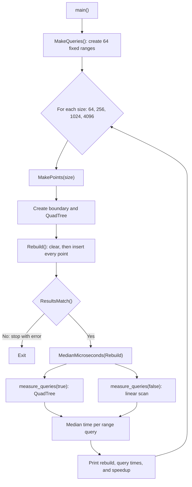
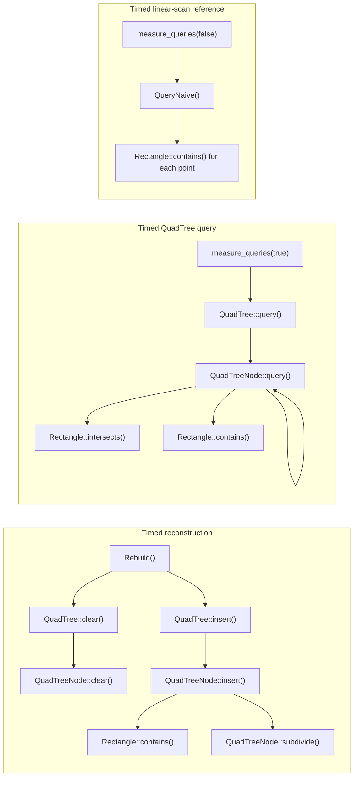

# QuadTree benchmark: execution flow and optimization candidates

This diagram follows the standalone benchmark in
[`quad_tree_benchmark.cc`](./quad_tree_benchmark.cc). It measures tree
reconstruction and compares range queries with a linear scan.

## Benchmark flow

`MakePoints`, `MakeQueries`, and `ResultsMatch` prepare or verify the workload;
they are not part of the timed rebuild/query sections. The correctness check
compares the points returned by the tree and the scan before timing.

## QuadTree call paths

## Functions worth investigating

Prioritize these only after measuring the same workload before and after a
change. The benchmark reports an isolated API cost, not total frame time.

1. **`QuadTreeNode::query` and `QuadTree::query`**
   ([`src/quad_tree.cc`](../src/quad_tree.cc#L14),
   [`src/quad_tree.cc`](../src/quad_tree.cc#L49)): each recursive call returns
   the accumulated `found` vector by value, even though child return values are
   ignored. This can copy results repeatedly. A shared accumulator with a
   `void`-returning recursive helper is worth testing; keep the public API and
   existing call sites in mind.

2. **`QuadTreeNode::clear` and `QuadTreeNode::subdivide`**
   ([`src/quad_tree.cc`](../src/quad_tree.cc#L65),
   [`src/quad_tree.cc`](../src/quad_tree.cc#L90)): `clear()` destroys child
   nodes, and rebuilding creates them again as the tree subdivides. Reusing
   nodes or pooling allocations may reduce rebuild cost, but adds complexity;
   verify that it helps the actual update workload.

3. **`QuadTreeNode::insert`**
   ([`src/quad_tree.cc`](../src/quad_tree.cc#L28)): insertion tries children
   in sequence, testing each child's boundary. Selecting the destination
   quadrant directly may avoid repeated tests. Take care to preserve the
   current behavior for points on split boundaries.

4. **`Rectangle::intersects` and `Rectangle::contains`**
   ([`src/quad_tree.cc`](../src/quad_tree.cc#L101),
   [`src/quad_tree.cc`](../src/quad_tree.cc#L107)): these checks are called
   repeatedly during tree queries and scans. They are possible hot spots, but
   optimize them only if profiling shows their arithmetic or repeated boundary
   calculations are significant.

## Benchmark-specific cautions

- `measure_queries` creates a result vector for every range. Allocation and
  result-copy costs are therefore part of the reported query time. Reusing
  buffers could make a different benchmark, but apply the same policy to both
  query methods.
- `QueryNaive` is the reference implementation; changing it changes the
  comparison baseline.
- `SortedKeys` and `ResultsMatch` are correctness-check helpers, not timed
  query work. `MedianMicroseconds` is measurement infrastructure, not a
  QuadTree hot path.
- In the previous run, the tree query was slower at 64 points and about five
  times faster at 4096 points. The existing sample has about 48 bodies and
  does not call `query()`, so query speedups do not directly improve that
  sample. Its rebuild cost and rendering/update work should be considered
  separately.

